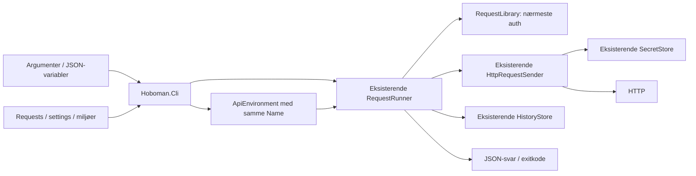

# fn-1-hoboman-cli-med-midlertidige-variabler Hoboman CLI med midlertidige variabler

## Goal & Context
<!-- scope: business -->

Gør gemte Hoboman-requests brugbare fra PowerShell, scripts og AI-agenter gennem CLI.md-funktionaliteten. Et script skal kunne sende en gemt request, læse svaret og sende en anden med en midlertidig værdi fra svaret. Genbrug eksisterende requests, mapper, miljøer, auth og historik.

Brugeren har godkendt et tyndt CLI oven på Core samt midlertidige variabler som første skridt mod senere workflows. Den fremtidige produktretning er nu konkretiseret: lange flows opbygget grafisk med drag/drop og forbindelser mellem requests, inspireret af Azure Data Factory, hvor store JSON-output kan blive input til senere trin. Planen er grundig; implementeringen skal følge KISS og undgå scope creep. Der findes endnu intet CLI-projekt. CLI.md er grundkravet; denne spec præciserer det og tilføjer variabelinput.

Brugere får et scriptbart værktøj; udviklere får en console-adapter og én genbrugelig Core-operation; installation udgiver to programmer i samme eksisterende datamappe. Ingen migration af GUI-flows eller filformater.

## Overview

Seks mellemstore opgaver: bevis variabeloverlejring og OAuth-identitet; etabler CLI og kommandokontrakt; forbind Core-afsendelse; tilføj variabelinput; verificer proces- og filadfærd; udgiv og dokumentér.

## Architecture & Data Models
<!-- scope: technical -->

Ny console-app src/Hoboman.Cli arver net10.0-windows fra Directory.Build.props:4 og har kun Hoboman.Core som projektreference. Assembly-navn hoboman-cli; namespace Hoboman.Cli.

Program.cs er composition root: UTF-8 streams, cancellation, AppFolder(AppContext.BaseDirectory), konstruktion/disposal af Core-services og kald af CLI-applikationen. Konstruktorinjektion giver testbare afhængigheder. Manuel sammensætning er tilstrækkelig til den lille faste graf; ingen Generic Host, ny DI-container eller fælles GUI-bootstrap. Brug eksisterende ILogger med NullLogger, så CLI ikke opretter logs eller blander logtekst i output.

CLI ejer argumenter, inputfiler, request-/miljøvalg, output og exitkoder. Genbrug RequestLibrary, RequestRunner, HttpRequestSender, HttpClients, SettingsStore, EnvironmentStore, SecretStore og HistoryStore. Ingen alternativ HTTP-, auth-, DPAPI-, historik- eller templatingkode. Disse services ændres kun hvis en konkret integrationstest viser en nødvendig lille rettelse.

Core-udvidelserne er to. Den ene er en ren operation på ApiEnvironment, WithVariables(IReadOnlyList<KeyValue> variables), der returnerer et nyt miljø med samme Name og de midlertidige værdier foran eksisterende variabler. Original liste og ApiEnvironment.None muteres ikke. CLI normaliserer dubletter (sidste vinder) før operationen. Intet EnvironmentStore.SaveAsync. Den anden er RequestRunner.RunAsync(..., Func<AuthSource, Task<bool>> fetchToken, ...): mangler eller er OAuth-tokenet udløbet, eller svarer serveren 401, og kan tokenet hentes uden login (client credentials, UnaskedTokens.CanFetch), hentes et nyt, og kaldet sendes én gang til. GUI og CLI bruger begge denne vej; CLI'et via UnaskedTokens med NoBrowser.

HistorySource.Cli findes allerede i src/Hoboman.Core/History/HistorySource.cs:3 (enum App, Cli); genbrug det uden enum-/format-/bagudkompatibilitetsændringer. Historik får denne source, oprindelig request/skabelon og miljønavnet. Variabelobjektet gemmes ikke. Dette string-baserede miljølag er kun tekstsubstitution; det er ikke den fremtidige workflow-run-context eller kontrakten for JSON-objekter. Substitution sker i Core ved afsendelse; CLI må ikke materialisere requestkopier med resolved headers/body før historikskrivning.

## API Contracts
<!-- scope: technical -->

- hoboman-cli list
- hoboman-cli send <gemt-request> [--env <navn>] [--var <navn=værdi>]... [--vars <fil|->]
- hoboman-cli send <METODE> <url> [--env <navn>] [-H <Navn: Værdi>]... [--json <tekst|@fil>] [--text <tekst|@fil>] [--var <navn=værdi>]... [--vars <fil|->]
- Standard --help og --version.

En positional efter send betyder gemt requeststi; to betyder metode/URL. En gemt request kaldet GET er entydig alene. Stier er extensionless, relative til requests og med / som list. RequestLibrary står for validering og Windows-filopslag; ingen stignavne-/filgæt.

list skriver én sti per linje, sorteret OrdinalIgnoreCase med Ordinal tie-break; ingen overskrift, JSON-wrapper eller .folder.json. Tomt bibliotek giver tom stdout/exit 0. list/help/version læser ikke auth eller miljøfiler og foretager ingen dataskrivning.

-H, --json og --text er kun til direkte requests. Gemte requests bruger gemt body, format, headers, Base64 og UseEnvironmentVariablesInBody. Direkte requests får nyt id, AuthSettings.None og name null; auth angives med header. Uden body-option vælges BodyKind.None eksplicit trods ApiRequest.New's JSON-standard.

-H deles ved første kolon; trim headernavnet, afvis tomt navn og CR/LF. Gentagne headers bevares i rækkefølge med eksisterende senders regler. Genbrug Core-metodevalidering; ingen whitelist af kendte verber.

--json og --text er gensidigt udelukkende. Indhold er tekst; --json vælger Content-Type, ikke stringify/parse. @fil læses UTF-8 med standard BOM-håndtering; relative inputstier er relative til shellens working directory. @@tekst sender bogstavelig @tekst. Filindhold der begynder med @ fortolkes ikke igen. Body-input fra stdin er ikke med.

Miljø: --env vinder over AppSettings.EnvironmentName. Intet valgt miljø giver ApiEnvironment.None. Eksplicit eller gemt valgt miljønavn som ikke findes giver exit 2 før HTTP; ingen lydløs auth-fallback. Navnematch er case-sensitive som EnvironmentStore.FindAsync. Valget gemmes ikke. Overrides uden gemt miljø bruger tom miljøidentitet.

--var deles ved første =; uden = giver exit 2. Navne valideres ikke og trimmes ikke, ligesom værdier. Tom værdi er gyldig; yderligere = tilhører værdien. Gentagen --var med samme eksakte navn: sidste vinder.

--vars accepterer én JSON-fil eller - for redirected stdin. JSON er ét objekt. En string-værdi bruges som tekst; andre værdier (tal, booleans, null, arrays, objekter) indsættes som deres rå JSON-tekst, fx et tal fra et tidligere svar. Dublerede nøgler: sidste vinder. Andet end et objekt eller ugyldig JSON giver exit 2. Dette er CLI-tekstvariabler, ikke generelle workflow-input; store objekter/arrays hører ikke til i --var/--vars. Stdin læses til EOF med cancellation; - uden redirected stdin giver exit 2.

Præcedens: sidste --var > --vars > aktive gemte miljøvariabler, uanset hvor --vars står i argumentrækken; kun rækkefølgen mellem gentagne --var med samme navn betyder noget. Overrides er aktive, også hvis et gemt felt med samme navn er disabled. Ingen OS-environment-import. ApiEnvironment.Resolve beholder case-sensitive enkeltpasserende adfærd: ukendte {{navne}} står urørte, erstatninger fortolkes ikke rekursivt.

Body: saved flag (UseEnvironmentVariablesInBody) bevares. Direct body substitueres aldrig. Variabler før Base64 som eksisterende Core. Ingen automatisk JSON-escaping af substitutionsværdier.

Dublerede singleton-optioner, ukendte optioner, manglende værdier, for mange positionals og ulovlige kombinationer giver exit 2 uden HTTP/historik. Disable System.CommandLine-responsefiles, så @fil er body-kontrakten. -- afslutter optioner. Optioner efter -- fortolkes aldrig som optioner og tæller med i 1/2 positional-arity; en ekstra positional giver exit 2.

HTTP-response, også 4xx/5xx, giver ét UTF-8 JSON-objekt på stdout: status, reason, elapsedMs, size, headers, body. headers er name/value-par; body er string med tekstsvaret, ikke parsed indlejret JSON. Det er CLI-transportformat, ikke workflowmotorens interne outputmodel. Serialisér wrapperen direkte som UTF-8 til outputstream med System.Text.Json, så CLI ikke bygger endnu en fuld escaped wrapper-string inden skrivning. Mapping i CLI er nødvendig: Core hedder StatusCode, kontrakten status. Bevar gentagne responseheaders.

Fejl før response giver tom stdout og ét stderr JSON-objekt med error som string. Brug korte kontrollerede beskeder for parser-, fil-, netværks-, auth- og cancellationfejl; ingen rå argumentværdier, exception.ToString eller stack traces. Missing/expired OAuth, der ikke kan hentes uden login, instruerer om at hente token i Hoboman. Normalisér unexpected exceptions ved ydergrænsen uden nyt Result-/fejlframework. Kontrollerede fejlkategorier er ugyldige argumenter, input kunne ikke læses, gemt request kunne ikke indlæses, ukendt valgt miljø, ugyldig URL, netværksfejl, timeout, afbrudt kald og missing/expired OAuth med GUI-instruktion. UriFormatException/HttpRequestException og andre exceptions mappes efter type til korte beskeder uden at kopiere Message; sentinel-værdier i resolved URL/header/body må ikke fremgå af stderr. Den eksisterende runner-historik er stadig omfattet af den beskrevne plaintext-begrænsning.

Exit 0: 2xx/list/help/version. Exit 1: modtaget HTTP-status udenfor 2xx. Exit 2: argument/inputfil/miljø/requestload/auth/netværk/timeout/cancellation. --help/--version viser standard tekst og er undtagelsen til JSON-output.

## Edge Cases & Constraints
<!-- scope: technical -->

- Saved send bruger fuld sti i RequestRunner for nærmeste mappe-auth. Direct bruger name null og AuthSettings.None, uden mappe-arv.
- OAuth læser gemt token for auth-ejeren/bevaret miljø. Ved client credentials henter CLI'et selv et nyt token med den gemte client secret, når tokenet mangler, er udløbet eller giver 401, gemmer det i secrets.json for det gemte miljø (ikke overlay'et) og sender én gang til. Ved authorization code åbnes aldrig en browser; kaldet fejler med GUI-instruktion. En auth-ejer uden id kan ikke få et token gemt og fejler.
- Inden for Hobomans executable-datafolder må CLI kun oprette/ændre history ved sends og secrets.json ved tokenhentning, og intet ved list/help/version/validering. Dette handler om applikationsdata, ikke SDK-buildoutput eller .NETs eventuelle single-file-runtimeudpakning udenfor datafolderen. Ingen request/mappe/env/settings/order/cleanup/logskrivning eller startup-oprydning. Manglende filer bruger eksisterende defaults uden oprettelse.
- Historik starter ved RunAsync: HTTP-svar og send/auth-fejl registreres. Parse/input/ukendt request/miljøfejl før RunAsync og bruger-cancellation giver ingen post.
- HistoryStore har allerede timestamp+GUID per kald til samtidige GUI/CLI-writes. Genbrug read-retries ved GUI-filændringer. Ingen nye globale låse/køer eller transaktionelt snapshot på tværs af filer under samtidig flytning/miljøændring.
- RequestRunner er best effort ved history-I/O-fejl: bevar response/exit, og gensend aldrig HTTP på grund af historikken. Den eneste gensendelse er tokenhentningen ovenfor; begge forsøg får hver sin historikpost. Docs skal sige at fuld disk/rettigheder kan forhindre historikpost; NullLogger giver ingen ekstra advarsel.
- SecretStore-auth indsættes ikke i request-recorden. Literal -H Authorization, bodies, responses og eksisterende Core-fejltekster kan være klartekst i historik. Variabelobjektet gemmes ikke, men overrideværdier kan forekomme i response, eksisterende fejl eller resolved address. Ingen garanti om secretfri historik. CLI-diagnostik dumper ikke vars/tokens.
- Anbefal --vars - for følsomme værdier for at undgå argv/shellhistorik. Inputfiler er brugerens; CLI opretter/sletter dem ikke. Dokumentér literal-header/history-begrænsningen.
- Data-root er executable-folder; working directory bestemmer kun relative inputfiler. DPAPI kræver samme Windows-bruger. Beskyttet installmappe kan forhindre historywrites; ingen datamigration.
- Console.CancelKeyPress afbryder CancellationTokenSource. Returner fra async Main og disponér HttpClients. Ingen Environment.Exit/fire-and-forget.
- Bevar eksisterende HTTP-buffering/timeout/response-tekst i CLI-leverancen. Request- og response-bodies er strings; HttpRequestSender buffer response, og Base64/JSON-DOM/history kan give flere fulde repræsentationer. Det er en dokumenteret grænse, ikke et løfte om bounded-memory workflowkørsler. CLI-output skal serialiseres direkte til stream uden ekstra fuld wrapper-string. Ingen ny HTTP-streaming, binære downloads eller retry-/timeout-optioner nu.
- Tests bruger temporary folders/lokale servers, aldrig rigtige secrets/live API. Ingen frontendtests/WPF-ændringer eller testpakke-/runneropgraderinger.

## Acceptance Criteria
<!-- scope: both -->

- **R1:** Console bygger som hoboman-cli med kun Core-projektreference; executable-folder deler data, og CLI opretter/ændrer inden for Hoboman-datafolderen kun history ved sends, secrets.json ved tokenhentning og intet ved list/help/version/validering.
- **R2:** list giver deterministiske extensionless requeststier, udelader metadata og afslutter tomt bibliotek med exit 0 uden writes.
- **R3:** Saved send genbruger indhold, fuld sti, nærmeste auth og body/Base64-indstillinger via RequestRunner.
- **R4:** Direct send understøtter metode/URL, gentagne headers, JSON/text inline/UTF-8 @fil; ingen body uden option og ingen mappe-auth.
- **R5:** --env/settings vælger korrekt miljø; ukendt valgt miljø fejler før HTTP, og valget gemmes ikke.
- **R6:** --var og --vars fil/stdin følger præcedens, også uden gemt miljø; ikke-tekstværdier indsættes som rå JSON; originalt miljø/Name bevares, og næste kald ser ikke overrides.
- **R7:** URL/query/headers/tilladte auth-værdier substitueres som i GUI; body kun for gemte requests med flaget slået til, ukendte vars bevares, variabler før Base64.
- **R8:** OAuth bruger korrekt ejer/miljø; client credentials hentes automatisk og sendes én gang til; authorization code giver exit 2 med GUI-instruktion uden browser.
- **R9:** Præcise responsefelter/string-body/Unicode, streams og exits 0/1/2, også parser/runtime/cancellation.
- **R10:** RunAsync-attempts giver HistorySource.Cli/original request ved succes/sendfejl; validering/cancellation giver ingen post; history-I/O-fejl gensender aldrig HTTP.
- **R11:** Ingen gemte variabelsamlinger/resolved requestkopier; andre datafiler end history og secrets.json (ved tokenhentning) er byte-identiske, og CLI-fejloutput dumper ikke tokens/argv. Existing plaintext-history-begrænsninger beskrives/testes uden falske redaktionsløfter.
- **R12:** Publish/install leverer self-contained GUI/CLI side om side med bevarede data; README/CLI.md dokumenterer PowerShell, chaining, exits, body-variabler, OAuth og historikbegrænsninger.
- **R13:** Store body-input går via fil frem for argv/escaped variabelobjekt: @fil sendes uændret, og et svar større end pipen skrives helt; response JSON serialiseres direkte til stream. Dokumentation adskiller dette bevis fra fremtidige typede workflow-input og bounded-memory-afvikling.

## Boundaries
<!-- scope: business -->

Lever CLI.md plus beskrevne variabeloptioner og nødvendig integration/tests/docs. Ingen workfloweditor, native batch/run-kommando, assertions-framework, scriptmotor, scheduler, plugins, persistente run-vars, refresh af tokens der kræver login, collection-writes eller bagudkompatibilitetslag. Ingen ændring af data-root, body-defaults eller secretformat. Den eneste UI-ændring er, at GUI'en bruger den samme automatiske client-credentials-hentning.

Senere workflows skal specificeres separat: rækkefølge, response-udtræk, stopbetingelser og run-context. Delt afvikling hører i Core, kaldt direkte af GUI/CLI; GUI skal ikke starte CLI-processer. Vurder vilkårlig scriptmotor først ved konkrete behov. Det er retning, ikke skjulte opgaver/abstraheringer nu.

## Future workflow design

Dette afsnit fastlægger retning og kendte grænser, ikke ny workflowkode eller GUI-opgaver i CLI-leverancen.

Brugsscenarier: A returnerer et stort nested JSON-objekt eller array, og B bruger hele resultatet som body; B bruger resultatet som en JSON-property sammen med egen template; C bruger et lille id fra A i URL/header, mens D bruger A's store objekt; en lang kæde sender store payloads videre uden at gemme kopier på alle forbindelser. Non-JSON response skal også kunne bruges som rå tekst. Samme requestdefinition kan bruges flere gange med forskellige input.

Workflow-definition og workflow-run holdes adskilt. Definitionen indeholder stabile node-id'er, requestreferencer, afhængigheder og eksplicitte inputbindings; grafiske koordinater hører til editor-layout. Et node-id er ikke request-id: samme request kan forekomme flere gange. Requestreference skal bevare identitet ved omdøbning/flytning; nuværende Guid/filstier undersøges ved workflow-specifikationen, inklusive duplicate-id og slettet request. Runtime indeholder node-status og output for denne ene kørsel, ikke saved miljøværdier eller GUI-viewmodels.

Drag/drop-editoren gemmer grafen, og forbindelserne bestemmer udførelsesrækkefølgen; placering på lærredet er ikke rækkefølge. Første workflowversion kan afvikle en kæde sekventielt. Modelretningen skal også kunne repræsentere flere afhængigheder og ét output med flere forbrugere; præcis branch/parallel/merge-UX og scheduling ligger i senere workflow-spec. Cykliske afhængigheder og manglende kilder skal afvises før send. Fejl/cancellation skal stoppe eller skippe afhængige trin efter en eksplicit politik, aldrig automatisk retry af side-effect requests.

Inputbinding vælges grafisk: kilde-node plus hele body eller en dokumenteret selector, mål hele requestbody/JSON-property/URL/query/header og eksplicit tekst- eller JSON-værdi. Objekt/array/number/boolean/null bevarer JSON-type; en string-værdi escapes korrekt ved indsættelse i JSON. Missing property adskilles fra JSON null. URL/header bruger skalare værdier med eksisterende encodingregler; et objekt i et scalar-felt kræver en eksplicit konvertering eller fejl. JSON-depth/number-præcision og selector-syntax skal specificeres og testes senere. Ingen ukritisk Regex.Replace af hele objekter eller konflikt med brugerens bogstavelige handlebars.

Workflowmotoren skal eje output-data/levetid: referér et tidligere resultat fra flere bindings i stedet for at stringify/parse/clone hele payloaden per node/edge. JSON parses efter behov; hvis JsonDocument/JsonElement vælges, ejer run-context dokumentet og holder det levende til sidste forbruger, derefter dispose. En consumer må ikke mutere en anden consumers input. Bounded parallelisme og frigivelse efter sidste forbruger skal forhindre hukommelsesvækst med alle afsluttede trin i lange flows. Disse er designkrav til senere afvikling, ikke garantier fra dagens string-body Core.

For væsentligt større payloads må den fremtidige body/output-kontrakt kunne bruge stream- eller file-backed indhold med reference/metadata i runtime. HTTP-buffering, history-serialisering, transformation/Base64 og GUI-preview skal vurderes samlet; bare at introducere en stream-type ændrer ikke de øvrige kopier. Store preview-data bør vises som et begrænset udsnit uden at blive lagt i viewmodel/diagramlabels for hver node. Memory-/tempfiles-grænser, cancellation/cleanup, preview og lagring af følsomme resultater fastlægges i workflow-spec før implementering.

Første CLI beviser, at en body via @fil sendes uændret, og at et svar større end pipen skrives helt. Det er regressionstests, ikke en produktgrænse. Store objekter sættes ikke i kommandolinje eller variabler. Testene er body-file til HTTP; de påstår ikke at være et grafisk flow eller objektbinding mellem gemte requests.

Kendte begrænsninger skal stå tydeligt: nuværende saved send accepterer ingen body-override, og --vars indsætter ikke-tekstværdier som rå JSON-tekst uden typebevarelse. Store response-to-saved-request bindings hører i den fremtidige Core-workflowmotor, som materialiserer et per-run request-input med bevaret auth-ejer/requestidentitet og uden at gemme det over requestdefinitionen. CLI's body-wrapper parse og @fil kan bruges af eksterne scripts til direkte sends, men er ikke den interne pipelinekontrakt. Der kræves ingen ændring af env-var-typen eller ny workflow-abstraktion nu.

Efter CLI anbefales en særskilt spec for Core-workflowmodel/afvikling og derefter drag/drop-editoren ovenpå. Den spec skal teste mindst hele output som næste body, typed property insertion, store arrays, output med to consumers, missing/null/type-mismatch, en lang kædes payloadfrigivelse og afbrudt cleanup. GUI og eventuel CLI-run kalder samme Core-motor direkte; ingen GUI-til-CLI-subprocesskæde og ingen vilkårlig scriptmotor som forudsætning.

## Decision Context
<!-- scope: both -->

Core-seams findes allerede (RequestRunner:11, RequestLibrary:57, HttpRequestSender:122). Den rene miljøoverlejring er eneste fælles nyfunktion; den muliggør senere genbrug uden ny execution-context-model.

Brug stabil System.CommandLine 2.0.12 direkte til argumenter, arity/help. To send-former, gentagne optioner, --, @fil og fejlkoder gør håndparser til reel specialkode. Ingen ekstra handler/binder-framework. Default Invoke-fejl printer help på stdout og exit 1; interceptér ParseResult.Errors til JSON/exit 2. Verificeret Microsoft parser-config dokumenterer ParserConfiguration.ResponseFileTokenReplacer = null som disablement, Command.Parse med ParserConfiguration, ParseResult.Errors/GetValue til parsing og InvocationConfiguration.Output/Error til help-tests. .2 beviser parsing/arity/@-tokens og kontrollerede parseproblemer; .3 ejer al JSON-outputserialisering og proces-exitmapping. Hvis disse egenskaber ikke kan bevises enkelt i .2, genvurder biblioteket og opdatér planen før videre arbejde; ingen parallel fallbackparser.

Manuel constructor-composition reducerer bootstrap og undgår default logs/config-hooks. Genbrug ILogger/IDisposable. Ingen service locator eller GUI App.Services-ændringer.

Én JSON-vars-indlæser med System.Text.Json; ingen config-provider-graf, OS-vars eller secretklassificering. Ingen vars-metadata i historik. Ukendte {{handlebars}} må gerne stå urørte; ingen global unresolved-var-validering. Global historikredaktion/kryptering er et særskilt produktvalg.

## Approach

1. .1 beviser immutable overlay og OAuth-miljø med Core-tests.
2. .2 etablerer projekt/parser og kontrollerede parseproblemer med @fil-/arity-/help-tests. JSON-serialisering og stream/exit-integration bygges samlet i .3.
3. .3 forbinder list, saved/direct input, Core, miljø/auth/history/cancellation.
4. .4 tilføjer var-kilder/præcedens og chaining.
5. .5 tilføjer proces-/filregressioner, inklusive en stor body-file og stream-output, som tidligere tests ikke dækker.
6. .6 tilpasser install/publish/docs og smoke-tester isoleret udgivelse.

Sekventielle dependencies er bevidste: .3/.4 deler CLI-applikation; .6 afhænger af executable-tests. Tests skrives med funktionaliteten; .5 er ikke en gentagelse af alle unit-tests.

## Verification & Non-functional Targets

Genbrug xUnit v3/Microsoft.Testing.Platform. Parser/help testes med StringReader/StringWriter; JSON-response/error-output testes med streams; applikation med injiceret AppFolder/clock/cancellation. Executable-tests kopierer CLI-buildfiler til temporary root. Testseams skaber ikke offentlig --data-root-option.

Matrix: tom/nested list; saved/direct 2xx/non-2xx; missing/corrupt input; miljøvalg/ukendt miljø; var-præcedens/tomværdi/=; JSON vars fil/stdin/typer; UTF-8/@/@@; headers/query; body-off/on med handlebars; Base64-rækkefølge; own/inherited OAuth og separate miljøtokens; missing/expired token; timeout/cancel; history-I/O-fejl; nul writes udenfor history; samtidige CLI-kald.

Assert server-observerede requests/streams. ProcessStartInfo.ArgumentList og samtidige stdout/stderr-reads undgår shell-escaping/deadlocks. Windows Ctrl+C får isoleret terminal-smoke; cancellation har deterministisk token-test. Ingen nye P/Invoke-testsignaler.

Performance: ét HTTP-kald per invocation (to ved tokenhentning), intet GUI-start, ingen læsning af hele historik, uændret buffering. Ressourcer frigives på alle exits. Ingen særskilt benchmarkprojekt eller kunstigt tidsbudget. Testene af store bodies og svar er funktionel regression; de beviser ikke bounded-memory lange workflows.

## Quick commands

Disse kommandoer bliver brugbare efter implementering; build/help/list er sikre smokes uden HTTP.

- dotnet build .\Hoboman.slnx
- dotnet test --project .\tests\Hoboman.Tests\Hoboman.Tests.csproj --filter-namespace Hoboman.Tests.Cli
- dotnet test --project .\tests\Hoboman.Tests\Hoboman.Tests.csproj --filter-not-namespace Hoboman.Tests.Views
- dotnet test --solution .\Hoboman.slnx
- dotnet run --project .\src\Hoboman.Cli -- --help
- dotnet run --project .\src\Hoboman.Cli -- list

Chaining-docs: send saved create-request, check $LASTEXITCODE, parse wrapper med ConvertFrom-Json, parse wrapper.body, udtræk id, send næste saved request med --var id=<værdi>. Ved følsom værdi vis JSON til --vars -. Ingen CLI-native workflowkommando.

## Rollout / Rollback

Tilføj løsning/install: publish GUI og CLI self-contained win-x64 single-file til samme publish-folder med separate navne. Check exit efter hver publish, start ikke GUI ved publishfejl. Install.ps1 venter eksplicit på både Hoboman.exe og hoboman-cli.exe med fuld path i target publish-folder før publish og beder brugeren lukke dem som eksisterende GUI-flow; dræb ikke processer med usaved data/kørende kald.

Publish-smoke i ny temporary mappe, ikke install.ps1 mod brugerens data. Begge executables findes; CLI-list virker fra anden working directory. Ingen sletning af data, CLI-genvej, PATH-mutation eller nye installerflags.

Docs siger implementeret først efter grønne smokes. Rollback af CLI-projekt/install/docs eller fjernelse af CLI-executable kræver ingen datamigration. Denne opgave er planlægning, ikke kode/commit.

## Risks & Mitigations

| Risiko | Modtræk |
|---|---|
| Overlay ændrer OAuth-nøgle | Bevar Name; test token kun gemt for Dev med overrides. |
| Parser spiser @body/lækker argv | Disable responsefiles; JSON parsefejl og sentinel-tests. |
| Body-vars beskadiger handlebars | Saved flag bevares; direct body substitueres aldrig; docs om manglende JSON-escaping. |
| Forkert data-root | AppContext.BaseDirectory + fremmed-working-directory-procestest. |
| Utilsigtede settings/secrets writes | Smal bootstrap, byte-snapshot af beskyttede filer. |
| Vars forekommer i svar/history | Original skabelon; konkret plaintext-begrænsning og stdin-anbefaling. |
| Historyfejl medfører dobbeltkald | Best-effort response; assert ét HTTP-kald ved skrivefejl. |
| Samtidig GUI-filændring | Eksisterende retries/kontrolleret exit; ingen snapshot-/låseudvidelse. |

## Early proof point

fn-1-hoboman-cli-med-midlertidige-variabler.1 beviser overlay gennem sender med samme miljøspecifikke OAuth-token. Hvis det kræver auth/sender-omskrivning, genvurder før resten. .2 giver et ekstra tidligt stop for @fil/JSON-parserfejl.

## Requirement coverage

| Req | Beskrivelse | Task(s) | Gap justification |
|---|---|---|---|
| R1 | Projekt/root/writes | .2, .3, .5, .6 | — |
| R2 | list | .3, .5 | — |
| R3 | Saved/arvet auth | .3, .5 | — |
| R4 | Direct/body-input | .2, .3, .5 | — |
| R5 | Miljøvalg | .3, .5 | — |
| R6 | Variabellag/præcedens | .1, .4, .5 | — |
| R7 | Substitution/body/Base64 | .1, .4, .5 | — |
| R8 | OAuth | .1, .3, .5 | — |
| R9 | Streams/exit/cancel | .2, .3, .4, .5 | — |
| R10 | Historikgrænser | .3, .5 | — |
| R11 | Writes/secret-output | .1, .3, .4, .5, .6 | — |
| R12 | Publish/docs/chaining | .6 | — |
| R13 | Stor body-file / stream-output / workflowgrænser | .3, .5, .6 | Typed graf/runtime og bounded-memory workflowexecution er konkret beskrevet, men leveres i senere workflow-spec. |

.1-.6 betyder fn-1-hoboman-cli-med-midlertidige-variabler.1-.6. Fremtidig workflow/scriptmotor har ingen krav/tasks i leverancen. Ingen aktive Flow-afhængigheder, repo-memory eller strategi fundet.

## References

- CLI.md:7-53; README.md:138-160; install.ps1:7; Directory.Build.props:4; Hoboman.slnx.
- src/Hoboman/App.xaml.cs:94-113; src/Hoboman.Core/Storage/AppFolder.cs:3; src/Hoboman.Core/Storage/JsonFile.cs:34.
- src/Hoboman.Core/Environments/ApiEnvironment.cs:6-21; src/Hoboman.Core/Environments/EnvironmentStore.cs:12.
- src/Hoboman.Core/Sending/RequestRunner.cs:11-39; src/Hoboman.Core/Requests/RequestLibrary.cs:23,34,57.
- src/Hoboman.Core/Sending/HttpRequestSender.cs:52,99,122,136; src/Hoboman.Core/Sending/ApiResponse.cs:5.
- src/Hoboman.Core/Auth/SecretStore.cs:16,49,110; src/Hoboman.Core/History/HistoryStore.cs:10; src/Hoboman.Core/History/HistoryEntry.cs:6; src/Hoboman.Core/History/HistorySource.cs:3.
- tests/Hoboman.Tests/Environments/ApiEnvironmentTests.cs; tests/Hoboman.Tests/Sending/HttpRequestSenderTests.cs:419-444; tests/Hoboman.Tests/Sending/RequestRunnerTests.cs:71-84.
- tests/Hoboman.Tests/Sending/EchoServer.cs; tests/Hoboman.Tests/TemporaryFolder.cs; tests/Hoboman.Tests/Hoboman.Tests.csproj; global.json.

Primære eksterne kilder:
- [System.CommandLine tutorial: ParseResult og Invoke-output](https://learn.microsoft.com/en-us/dotnet/standard/commandline/get-started-tutorial).
- [Stabil System.CommandLine 2.0.12](https://www.nuget.org/packages/System.CommandLine/2.0.12).
- [ParserConfiguration.ResponseFileTokenReplacer, InvocationConfiguration.Output/Error](https://learn.microsoft.com/en-us/dotnet/standard/commandline/how-to-configure-the-parser).
- [System.CommandLine syntax](https://learn.microsoft.com/en-us/dotnet/standard/commandline/syntax).
- [Single-file og app-relative paths](https://learn.microsoft.com/en-us/dotnet/core/deploying/single-file/overview).
- [Console.CancelKeyPress](https://learn.microsoft.com/en-us/dotnet/api/system.console.cancelkeypress?view=net-10.0).
- [DPAPI CurrentUser](https://learn.microsoft.com/en-us/dotnet/standard/security/how-to-use-data-protection).
- [Microsoft.Testing.Platform](https://learn.microsoft.com/en-us/dotnet/core/testing/microsoft-testing-platform-intro).
- [ADF pipeline-aktiviteter og dependencies](https://learn.microsoft.com/en-us/azure/data-factory/concepts-pipelines-activities).
- [ADF typed pipelineparametre](https://learn.microsoft.com/en-us/azure/data-factory/concepts-parameters-variables).
- [System.Text.Json DOM og dokumentlevetid](https://learn.microsoft.com/en-us/dotnet/standard/serialization/system-text-json/use-dom).
- [Utf8JsonReader og store stream-input](https://learn.microsoft.com/en-us/dotnet/standard/serialization/system-text-json/use-utf8jsonreader).

